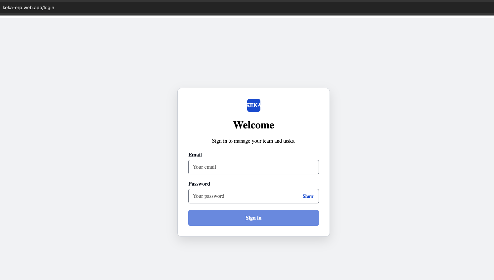
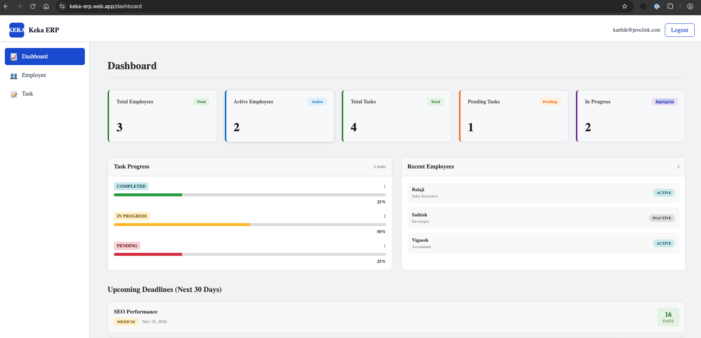
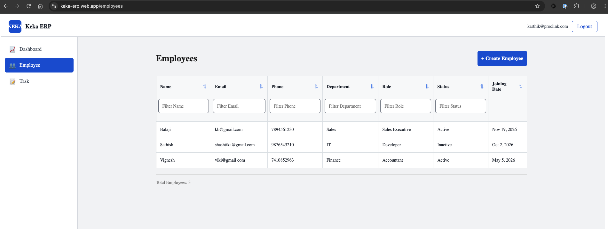
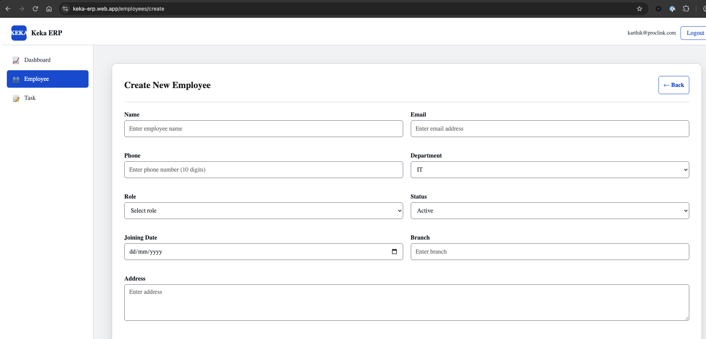
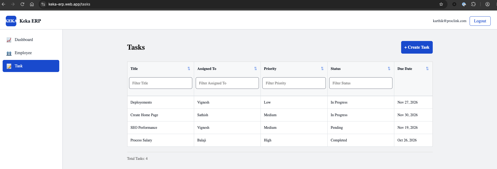
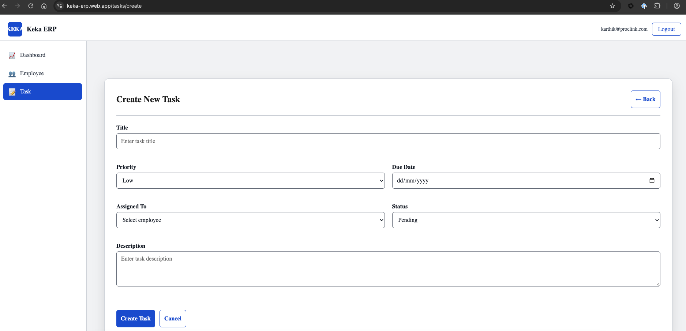

# Keka ERP

## About This Project

This project is a proof of concept (POC) built with Angular to explore core concepts such as services, signals, routing, and reusable components. The app provides employee and task management with Firebase integration.

## Start the Project

Install dependencies and run the local development server:

```bash
npm install
npm start
```

Open `http://localhost:4200/` in your browser. To create a production build, run `npm run build`.

## Project Structure

```text
src/
	app/
		components/       Shared UI components
		firebase/          Firebase app and client configuration
		guards/            Route guards
		layout/            Main application layout
		models/            Employee and task models
		pages/             Dashboard, login, employee, and task pages
		services/          Authentication, Firestore, and feature services
		validators/        Form validators
	environments/        Firebase environment configuration
public/                Static assets
screenshots/            Project screenshots
```

## Screenshots

### Login



### Dashboard



### Employee List



### Create Employee



### Task List



### Create Task



## Firebase Implementation

Add your Firebase configuration values in `src/environments/index.ts`:

```typescript
export const environment = {
	API_KEY: 'YOUR_API_KEY',
	AUTH_DOMAIN: 'YOUR_AUTH_DOMAIN',
	PROJECT_ID: 'YOUR_PROJECT_ID',
	STORAGE_BUCKET: 'YOUR_STORAGE_BUCKET',
	MESSAGING_SENDER_ID: 'YOUR_MESSAGING_SENDER_ID',
	APP_ID: 'YOUR_APP_ID',
	MEASUREMENT_ID: 'YOUR_MEASUREMENT_ID',
};
```

- Hosted on Firebase: [https://keka-erp.web.app](https://keka-erp.web.app)
- Firebase Authentication: Email/Password sign-in.
- Cloud Firestore: Stores employee and task information.
